# DoVideo-AI

面向视频内容理解的工作台：导入视频、提取文字，围绕分析目标生成带时间戳证据的结构化内容。

本仓库基于 [Xiaoc7r/DOVideo-AI](https://github.com/Xiaoc7r/DOVideo-AI) 继续开发。当前改动聚焦前端视觉统一与功能展示，沿用原有 Vue 3、接口、鉴权和任务流程。感谢原项目提供的视频处理链路、Video Agent 实现与测试基础；版权与许可见 [LICENSE](LICENSE)。

## 项目预览

以下图片均于 2026-10-17 从本地实际运行的改版前端截取，使用仓库内相对路径，未使用原作者截图替代本次效果。

带 **demo** 的图片使用原项目自带的 `?demo` 固定示例；课程条目、转写、AI 结果、执行耗时与评估比例均为内置示例，**不是本次上传视频、调用模型或性能测试产生的结果**。演示页面也有明确提示；它不提供原视频播放。

### 导入与视频资料库

本地文件与链接导入集中在工作台中；资料列表显示文件名称、时间、处理状态，以及下载音频、提取文字和 Video Agent 的已有入口。

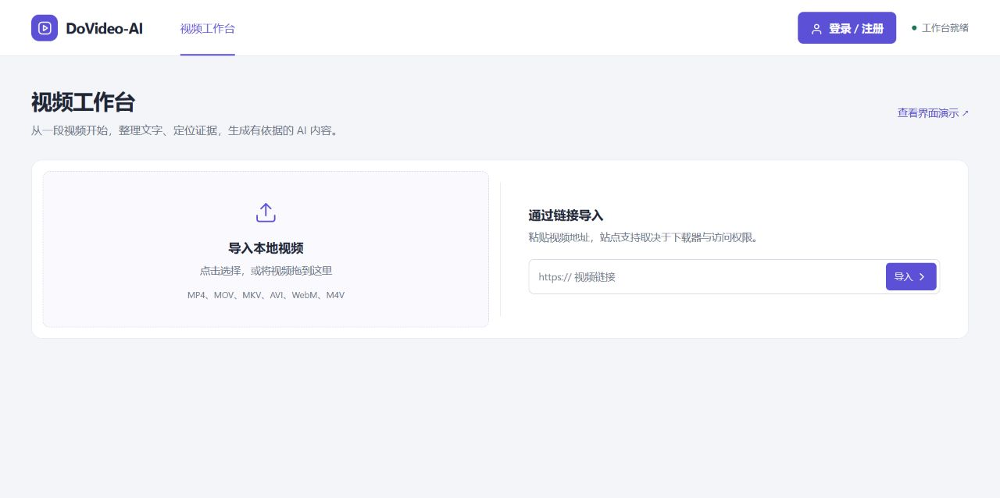

资料库示例：可按名称搜索视频，并进入文字或 AI 内容处理。此处只有一条原有内置课程数据，没有人为补充用户数量或虚假任务。

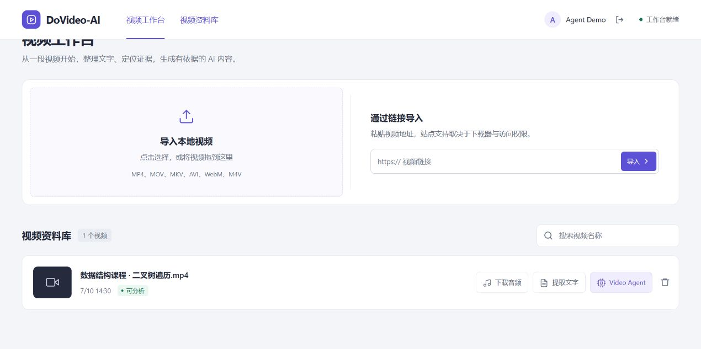

### 设置分析任务

选择通用、学习、审查、创作或自动模式，填写目标，或使用已有的学习笔记、会议纪要、操作手册预设。左侧保留视频与当前目标的上下文，右侧专注任务设置。

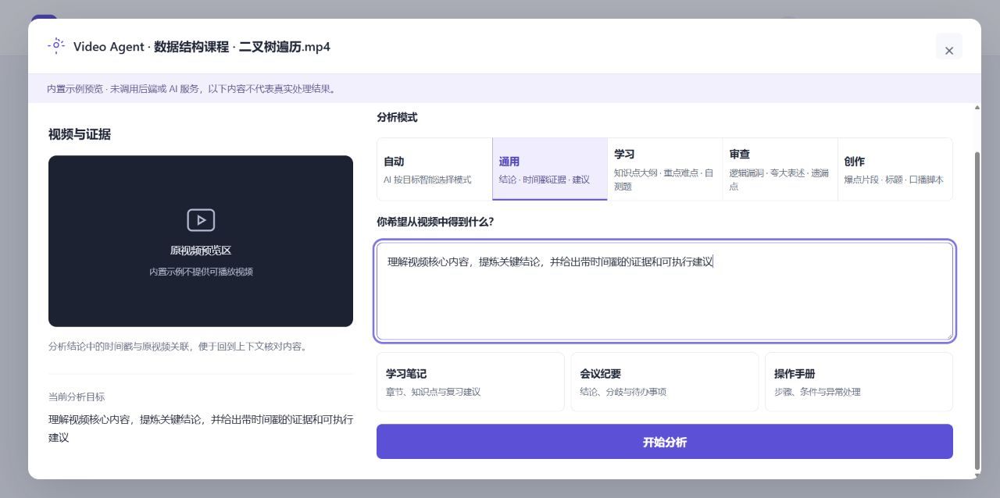

### 结构化结果与证据

在同一面板中阅读结论、时间戳证据与建议，使用复制、Markdown 导出与分析详情入口。截图中的结果为内置示例；真实视频播放、证据跳转、检索与模型生成仍需后端联调。

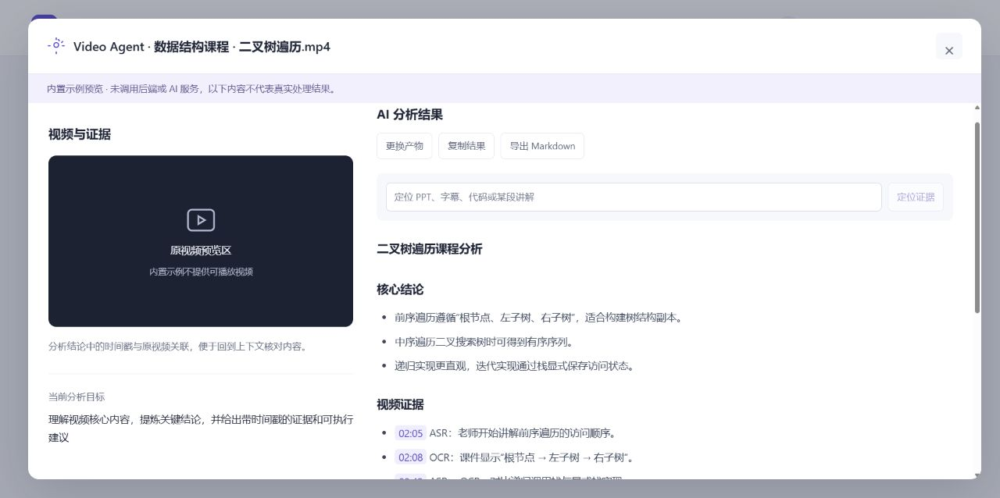

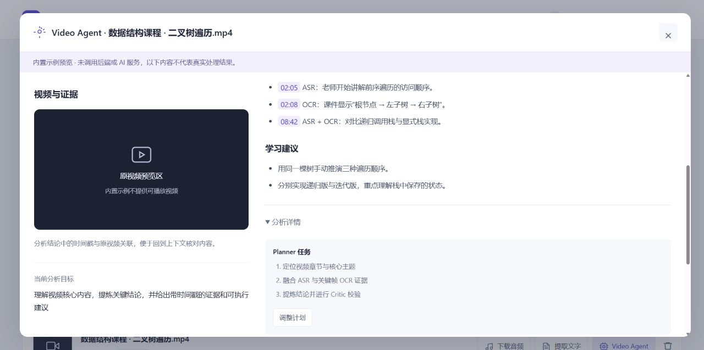

### 文字转写

已有转写面板提供全文、字数、复制与文本导出。本次实际检查了示例内容的显示与导出；截图中的 30 字文本不是本次 ASR 调用结果。

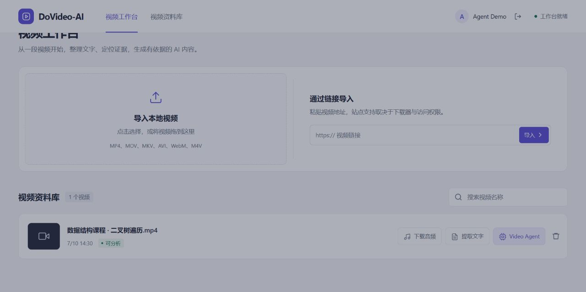

<details>
<summary>登录、注册与手机页面</summary>

登录与注册使用一致的表单布局，保留原有字段、校验、鉴权与切换流程。截图未填写密码或个人资料；本次没有连接后端完成注册或登录。

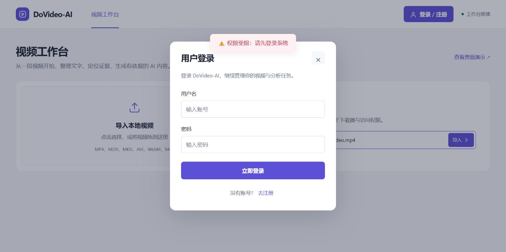

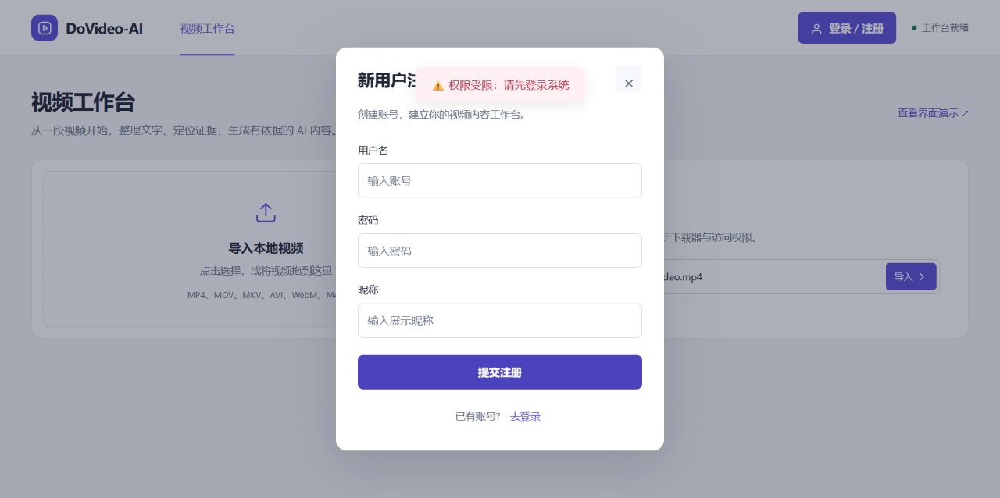

手机检查使用实际 390px CSS 视口。上传区域上下排列，分析面板按视频与内容垂直展示，注册窗口在屏幕内滚动。

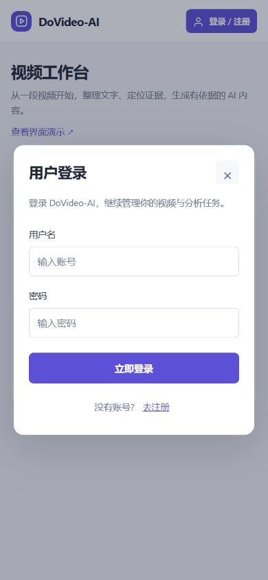
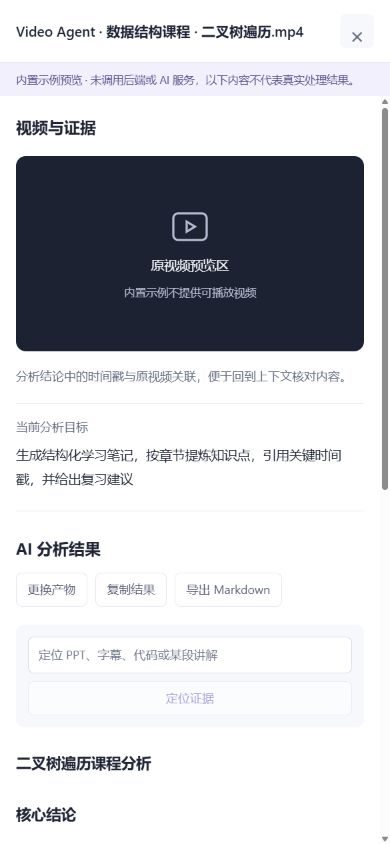

</details>

## 本仓库改动与开发边界

| 范围 | 当前状态 |
| --- | --- |
| 原有能力 | 视频导入、资料库、异步处理、转写、Video Agent、检索、SSE、任务恢复等均来自原项目；本次未重写业务实现 |
| 界面改进 | 浅灰背景与白色面板、统一字体与按钮、蓝紫色主操作、列表布局、桌面双栏详情、手机适配、演示来源提示 |
| 文档改进 | 本地截图、功能说明、来源致谢、运行方式与验证边界 |
| 后续业务扩展 | 本次没有新增；口播编辑等想法尚未实现，不作为当前功能展示 |

之前的深色荧光、斜切上传区与宣传式标题，已调整为任务导向的工作台。视觉约定见 [DESIGN.md](DESIGN.md)。

<details>
<summary>改版前截图（本次从原有界面运行截取）</summary>

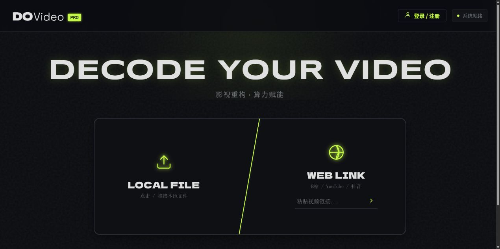

</details>

## 先查看前端

安装 Node.js 22 或更新的兼容版本，在仓库根目录运行：

```bash
cd client
npm ci
npm run dev -- --host 127.0.0.1
```

- 工作台：`http://127.0.0.1:5173/`
- 内置界面演示：`http://127.0.0.1:5173/?demo`（无需后端，固定示例不代表真实处理）
- 正常业务默认通过 Vite 代理访问 `http://localhost:9090`；鉴权、上传和真实分析需要完整后端环境。
- 现有应用没有独立前端路由，登录、转写和分析通过弹层展示。

## 本次验证（2026-10-17）

| 项目 | 结果 |
| --- | --- |
| 生产构建 | 通过，Vite build |
| 前端现有测试 | 25/25 通过，覆盖 API 会话、上传恢复、任务事件、分析工作区及时间戳 |
| 桌面与手机界面 | 已检查导入、列表、搜索空态、登录/注册、任务设置、转写与结果面板；修复手机注册窗口溢出 |
| 关键前端操作 | 已检查未登录导入拦截、必填校验、模式/目标预设、搜索与清除、Escape 关闭、示例结果切换、复制和文件导出 |
| 完整后端链路 | 未验收：本机 `9090/health` 不可用，未配置运行所需的中间件与模型服务 |
| 真实媒体与 AI | 未验收：上传/断点续传联调、真实 ASR/OCR、视频播放跳转、证据检索、SSE 和真实 AI 生成均不由演示截图证明 |

现有依赖审计另报告 **4 项 high 告警**，涉及 Vue 及其依赖；本次未升级依赖、未改锁文件。详情、复现命令与截图清单见 [界面验收记录](docs/ui-redesign-validation.md)。

## 原有核心能力

以下能力继承自原项目，按代码与原 README 的分类整理；本次完成的是前端视觉与交互展示检查，不等同于以下后端链路已在本机验收。

长视频处理是**长耗时、高资源消耗、外部调用成本敏感**的场景。DoVideo-AI 的设计都围绕这一背景展开，可以概括为四层能力。

### 🎬 可靠的视频任务链路

> 把大文件上传与耗时的视频解析从请求主链路中剥离，通过异步任务、幂等控制和重试机制管理长耗时处理。

- **分片上传 + 断点续传** — 前端按 5 MB 分片，Redis 记录已完成分片，MinIO 保存合并后的视频，弱网中断后可从断点续传。
- **异步削峰** — RocketMQ 将视频解析移出请求线程，提交后立即返回任务 ID；Redisson 按「内容指纹 + 分析目标」加锁，拦截并发与重复消费。
- **成本护栏** — 用户级与全局令牌桶限制 AI 请求速率；ASR 与模型调用采用有限次数的指数退避重试，兜底第三方网络抖动。

### 🧩 时序多模态 VideoContext

> 把语音、画面文字与时间戳融合成一份可检索、可校验的统一上下文。

- **双分支抽取** — FFmpeg 将音频按 60 秒切片，同时通过场景变化检测抽取关键帧，并以 30 秒保底采样避免遗漏静态板书。
- **并行与容错** — ASR 与 OCR 使用独立有界线程池并行执行；相邻画面通过感知哈希去重，单路失败时仍保留另一条有效信息。
- **统一结构** — 语音区间、OCR 文本、关键帧与时间戳被合并为统一的 `VideoSegment`，后续检索与校验不再依赖底层模型格式。

```text
[02:00 - 03:00]
ASR      接下来讲解二叉树的前序遍历
OCR      前序遍历：根节点、左子树、右子树
Evidence frame_000125.jpg
```

### 🔁 有证据约束的 AgentLoop

> 每条结论都必须绑定可在原始视频中核验的时间戳证据，通过证据约束与程序校验降低无依据结论的风险。

- **角色分工** — Planner 将用户目标拆成可执行任务，Executor 生成固定结构的结论、证据与建议。
- **闭环校验** — Critic 检查目标覆盖、结构完整性与时间戳证据；不通过时依据缺失内容和时间范围定向重新检索。
- **自动模式路由** — 根据用户目标自动选择通用、学习、审查或创作模式；路由不可用时回退通用模式，不阻断分析任务。
- **四类结构化产物** — 通用模式生成结论与建议，学习模式生成大纲、自测题与易错点，审查模式定位逻辑漏洞与存疑结论，创作模式提取爆点、标题与口播脚本。
- **成本可控** — AgentLoop 最多执行两轮，既允许定向修正，也通过轮次上限约束延迟与 Token 成本。

### 🔍 长视频检索与断点恢复

> 面向数小时长视频的分段检索，以及分阶段可恢复的任务状态机。

- **混合检索** — 每 5 分钟生成片段摘要、关键词与 Embedding，通过关键词匹配与 Qdrant 语义召回选出 TopK 原始证据。
- **优雅降级** — Qdrant 或 Embedding 服务不可用时，退化到本地关键词与已有向量排序，不阻断主分析链路。
- **断点恢复** — Checkpoint 以 MySQL 为恢复真源、Redis 为热缓存，持久化 `VideoContext`、分块、计划、Critic 状态与最终结果。
- **状态可观测** — 前端通过 SSE 接收任务阶段；失败消息写入独立失败主题与失败任务表，可由管理接口重新投递。

## 系统流程

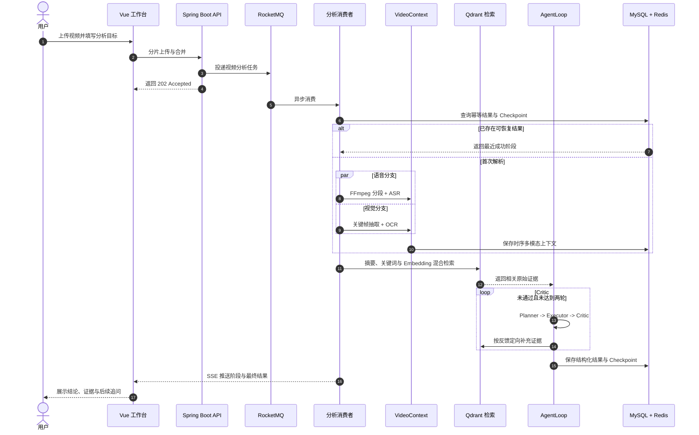

## 技术栈

| 层次 | 技术 | 用途 |
| :--- | :--- | :--- |
| Web | Vue 3、Vite、SSE、Marked | 上传、Agent 工作台、实时进度与安全 Markdown 展示 |
| API | Java 21、Spring Boot 3.5.9、Undertow、MyBatis-Plus | 鉴权、媒体管理、任务编排与 REST API |
| 异步与缓存 | RocketMQ 5.3.4、Redis 7.4、Redisson | 异步削峰、状态缓存、限流、锁与消费幂等 |
| 数据与存储 | MySQL 8、MinIO、Qdrant | 业务数据、视频对象、Checkpoint 与向量检索 |
| 视频与 AI | FFmpeg、Tesseract、LangChain4j、DeepSeek、TeleSpeechASR、BGE-M3 | 音视频处理、多模态解析、Agent 推理与 Embedding |
| 部署 | Docker Compose | 本地中间件编排 |

## 完整系统运行

### 环境要求

| 组件 | 要求 | 说明 |
| :--- | :--- | :--- |
| JDK | 21 | 后端运行环境 |
| Node.js | 22 | Vue 与 Vite 构建环境 |
| Docker | Compose v2 | 启动 MySQL、Redis、MinIO、Qdrant 与 RocketMQ |
| FFmpeg | 可在终端调用 | 音频切分与关键帧抽取 |
| Tesseract | 安装 `chi_sim` 与 `eng` | 中英文关键帧 OCR |
| yt-dlp | 可选 | 仅解析在线视频链接时需要 |

建议先确认命令均可用：

```bash
java -version
node --version
docker compose version
ffmpeg -version
tesseract --version
```

### 1. 准备配置

```bash
cp .env.example .env
```

编辑 `.env`，至少替换数据库、Redis、MinIO、Qdrant 的示例密码并设置 `SILICONFLOW_API_KEY`。全新数据库中 `DB_USERNAME` 与 `MYSQL_APP_USER` 应保持一致；`MYSQL_ROOT_PASSWORD` 仅供数据库初始化使用。密钥只保存在本地 `.env`，不要提交到仓库。

`.env.example` 默认 LLM 为 `deepseek-ai/DeepSeek-V3.2`，实际可用性以服务商当前支持为准。`LLM_TIMEOUT_SECONDS` 默认是 `300`，用于避免长视频证据分析在模型响应尚未返回时过早超时；模型或超时配置变更后需要重启后端。

### 2. 启动中间件

```bash
./scripts/dev-up.sh
```

脚本会检查本机命令与版本、校验 Compose 配置，并等待 MySQL、Redis、MinIO、Qdrant 和 RocketMQ 启动。中间件与后端默认只监听 `127.0.0.1`，不会直接暴露到局域网；远程部署时再显式修改 `SERVER_ADDRESS` 并配置反向代理。

### 3. 启动后端

```bash
set -a
source .env
set +a

cd server
./mvnw spring-boot:run
```

后端默认地址为 `http://localhost:9090`，启动时会初始化项目所需数据表。另开终端确认服务可用：

```bash
curl http://localhost:9090/health
```

成功时返回 `{"code":0,"message":"success","data":"UP"}`。

### 4. 启动前端

```bash
set -a
source .env
set +a

cd client
npm ci
npm run dev
```

浏览器访问 `http://localhost:5173`。开发环境默认通过 Vite 代理访问后端；后端地址不同时修改 `VITE_DEV_PROXY_TARGET`，前后端分开部署时再设置 `VITE_API_BASE_URL`。

只查看前端 Agent 工作台时，可以打开 `http://localhost:5173/?demo`。Demo 模式使用内置示例数据，不依赖后端服务。

### 常见问题

| 现象 | 处理方式 |
| :--- | :--- |
| 后端无法连接 MySQL 或 Redis | 运行 `docker compose --env-file .env ps`，确认服务健康且 `.env` 密码一致 |
| 页面提示无法连接后端 | 先访问 `/health`；再检查 `VITE_DEV_PROXY_TARGET` 或 `VITE_API_BASE_URL` |
| 视频解析提示命令不存在 | 确认 `ffmpeg`、`tesseract` 可在终端执行，必要时配置 `FFMPEG_DIR`、`OCR_COMMAND` |
| AI 接口返回 401 或模型不可用 | 检查 `SILICONFLOW_API_KEY` 与模型名称，修改后重启后端 |
| Maven 提示 `maven-default-http-blocker` | 在 `server` 目录执行 `./mvnw -s .mvn/central-settings.xml spring-boot:run`，临时绕过失效的用户级镜像 |

停止本地中间件：

```bash
docker compose --env-file .env down
```

该命令不会删除 `mysql/data`、`redis/data`、`minio/data`、`qdrant/data` 或 RocketMQ 命名卷。需要完全重置时请先备份，再使用 `docker compose --env-file .env down --volumes` 并手动清理这些数据目录。

## 目录结构

```text
DoVideo-AI
├── client/              # Vue 3 工作台
├── server/              # Spring Boot API 与 Video Agent
├── rocketmq/            # Broker 配置
├── docker-compose.yml   # 中间件编排
└── .env.example         # 本地配置模板
```

## License

本项目基于 [MIT License](LICENSE) 开源。
