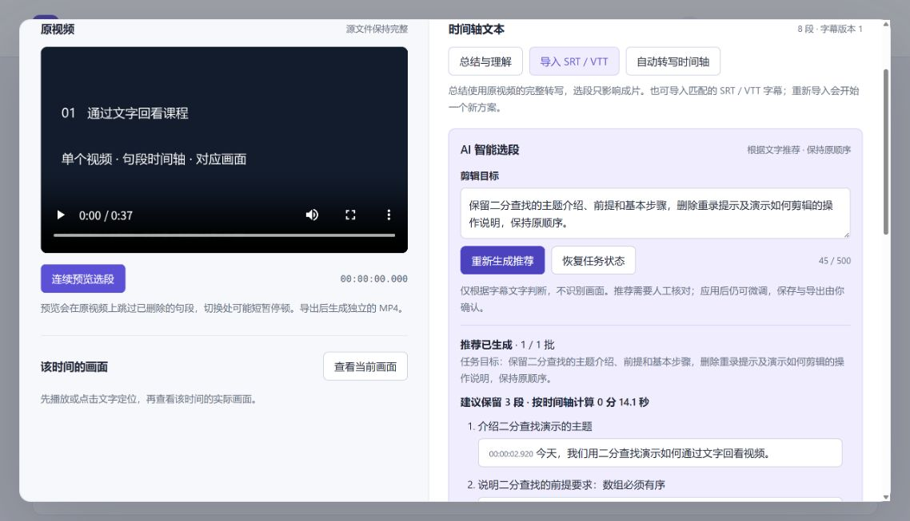
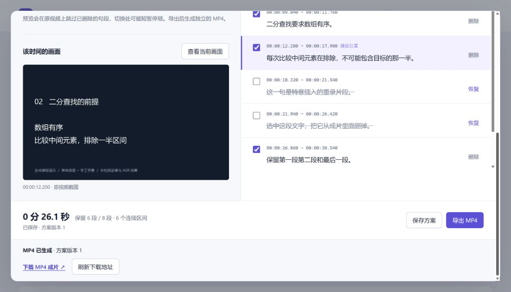
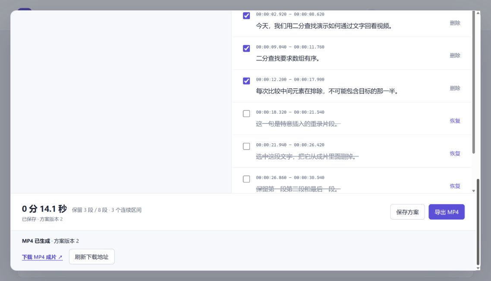
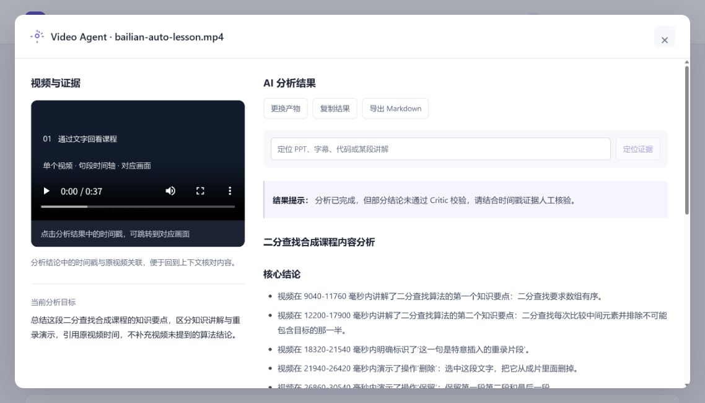

# DoVideo-AI

**面向长视频内容理解与视频编辑的 Video Agent 平台。**

支持大文件分片接入、多模态内容解析、目标驱动分析、结果校验与结构化产物生成。基于共享时间轴文字稿，进一步支持文本驱动剪辑与 AI 智能选段：从理解视频内容，到选出需要保留的部分并导出成片。

```text
上传视频 → 自动生成时间轴文字
                ├─ 总结理解 → 结论 + 时间戳证据
                └─ 手动选段 / AI 推荐 → 预览微调 → 导出视频
```

## 实际效果

以下为本地真实运行截图。素材是 **37.32 秒自制合成课程视频**，百炼实际识别出 8 个句段；推荐来自真实模型调用。

### 描述目标，获得推荐与理由

输入“保留二分查找的主题介绍、前提和基本步骤”，AI 选出 3 句知识讲解，排除重录提示和剪辑操作说明。用户可以逐段回看，再决定是否应用。



### 按文字回看、删段，核对对应画面

点击文字定位原视频，获取该时刻的实际画面；取消保留整句段，预览时跳过对应内容。也支持手动导入 SRT/VTT。



### 确认方案，生成独立 MP4

推荐的 3 句总计 14.12 秒，实际导出 **14.16 秒、H.264/AAC、1280×720** 的 MP4，已下载并播放至结尾。保存后重开可继续编辑。



<details>
<summary>查看 AI 总结与理解</summary>

同一份文字稿也可生成总结与时间戳证据。该次真实模型分析仍有部分结论未通过 Critic，页面保留人工核验提示。



</details>

**主要技术：** Spring Boot · MySQL · Redis · RocketMQ · MyBatis-Plus · MinIO · LangChain4j · Vue 3 · FFmpeg

## 核心技术与实现亮点

### 1. RocketMQ 异步调度：让提交与处理分离

视频解析和模型分析耗时较长，接口只负责接收任务，不等待整条处理链路结束。

- **异步编排：** 通过 RocketMQ 投递视频分析任务，由消费者处理解析、检索与 Agent 分析。
- **进度反馈：** 提交后返回受理状态，前端通过 SSE 查看任务阶段和结果；关闭面板后仍可恢复查看。
- **阶段恢复：** 通过 Checkpoint 保存上下文、计划与执行结果，重试时复用已完成阶段，减少重复计算。

接口受理与耗时处理解耦，前端能够持续查看任务进展。

### 2. Redisson + MD5：内容去重与消费幂等

同一段视频重复上传、相同目标重复提交或消息重复投递，都可能重复消耗媒体处理与模型资源。

- **内容指纹：** 使用 MD5 标识视频内容，为结果复用提供依据。
- **并发互斥：** 使用 Redisson 分布式锁协调同一任务及内容目标范围内的处理，结合完成标记控制重复消费。
- **按目标隔离：** 将内容指纹与分析目标纳入任务身份，区分“相同内容的重复请求”和“不同目标的新分析”。

时间轴剪辑模式还会核对实际句段来源；不能只因文件相同就复用不匹配的旧上下文。

### 3. 分片上传与断点续传：中断后只补缺失分片

大文件一次性传输失败，容易迫使用户从头上传。上传链路将文件拆成小块，分别记录和重试。

- **分片传输：** 前端按 5 MB 切片，Redis 记录已完成分片状态，重试时跳过已有分片。
- **统一合并：** 完成分片上传后发起合并，视频由 MinIO 保存，后续处理复用同一媒体资源。
- **恢复保护：** 保留上传进度，处理临时状态查询失败、合并响应丢失与账号切换，避免错误清除可恢复数据。

### 4. Redis 请求限流：为模型调用设置成本入口

AI 请求不仅占用服务资源，也会产生外部调用费用。分析、追问、证据检索与智能选段统一接入请求配额。

- **双层限制：** 使用 Redis / Redisson 限流器，分别约束用户请求频率与全局请求频率。
- **统一入口：** 生成推荐同样需要配额，不能通过新增接口绕过已有 AI 请求限制。
- **有限执行：** 请求限流与模型调用预算配合使用，避免“入口没超频、单个任务却无限调用”。

当前按分钟配置配额；频率限制控制请求数量，Token 和费用仍需结合实际模型用量评估。

### 5. 指数退避重试：区分暂时失败与无效请求

第三方模型可能出现网络超时、限流或服务抖动，立即密集重试会放大故障和额外开销。

- **延迟递增：** 对可重试模型错误采用指数退避，等待后再发起请求。
- **次数有界：** 文本模型调用最多尝试 3 次，任务同时受执行时间预算约束。
- **保留失败状态：** 无效请求不无限重试，达到上限后记录失败并向页面反馈；选段部分批次成功不能被标记为整体完成。

### 6. 版本快照 + 异步导出：像编辑文字一样剪视频

用户按文字删除内容后，需要将选择转换成真实视频；导出期间继续修改草稿，也不能改变正在生成的成片。

- **共享时间轴：** 接入句段级 ASR，保留文字 ID、原文与起止时间，同一份文字服务总结、定位与剪辑。
- **快照一致性：** 剪辑方案引用固定字幕版本，导出绑定已保存方案快照，隔离之后的草稿修改。
- **后台生成：** 使用独立有界执行器调用 FFmpeg 裁剪、拼接，MySQL 保存任务状态，支持连续预览、保存恢复及 MP4 下载。

原视频保持完整。转写、选段和导出使用独立后台执行器，与 RocketMQ 视频分析链路分别管理。

### 7. 重叠分批 + 输出校验：让 AI 推荐可执行的片段

用户描述“保留知识讲解，删除重录内容”，模型需要产出能够可靠执行、也能人工调整的剪辑建议。

- **上下文分批：** 按句数与文字长度限制拆分长稿，相邻批次尽量保留重叠句，合并后去重并恢复原视频顺序。
- **编号约束：** 模型只返回句段 ID 和理由；后端检查格式、当前字幕归属及编号有效性，再映射真实时间，不使用模型猜测的剪辑点。
- **人工可控：** 推荐生成不修改已有方案，用户明确应用后才更新草稿；迟到结果不能覆盖等待期间的手动修改。
- **资源边界：** 每批最多 100 句、12000 字符，单任务最多 20 批、8 分钟；每批调用前检查媒体归属，避免删除视频后继续调用。

该功能按文字与用户目标推荐内容，不判断表情或动作。用户可以回看、微调，再通过同一条导出链路生成成片。

内容理解另支持 **ASR / OCR 时序融合、Planner–Executor–Critic、关键词与 Embedding 检索**；完整设计见[技术架构](docs/architecture.md)。

## 技术栈与源码入口

| 模块 | 技术 | 主要位置 |
| --- | --- | --- |
| 工作台与文本编辑器 | Vue 3、Vite | `client/src/components/TextVideoEditor.vue`、`useTextVideoEditor.js` |
| 时间轴、选段与导出 | Java 21、Spring Boot、FFmpeg | `server/.../editor/` |
| 内容理解与检索 | LangChain4j、Planner–Executor–Critic、Qdrant | `server/.../service/` |
| 状态与持久化 | MySQL、MyBatis-Plus、Redis、Redisson | Mapper、Checkpoint 与任务表 |
| 分析调度与对象存储 | RocketMQ、MinIO | 消费者、存储工具与 Compose 配置 |
| 语音与文本模型 | 百炼 Paraformer、硅基流动 | 独立配置语音转写和文本模型 |

## 快速运行

需要 JDK 21、Node.js 22+、Docker Compose 和 FFmpeg。复制 `.env.example` 为 `.env`，配置服务密码；自动转写填写百炼 Key，总结和智能选段填写硅基流动 Key。

```powershell
# Windows，项目根目录：启动依赖
powershell -File scripts/dev-up.ps1 -SourceMinio

# 新终端：启动后端
powershell -File scripts/dev-server.ps1 -JavaHome "你的 JDK 21 安装目录"

# 新终端：启动前端
cd client
npm ci
npm run dev
```

访问 `http://localhost:5173`。只查看固定界面示例可打开 `/?demo`，该模式不调用模型。

[完整运行指南与排错](docs/running.md) · [百炼配置](docs/bailian-setup.md)

## 验证与边界

最近一次完整验证：**后端 159 项测试、前端 76 项测试及构建通过**。短合成素材已走通真实转写、AI 推荐、人工确认、保存、导出与播放。

当前未专项测量“60 秒降至 50ms”及 GB 级弱网上传效果。按整句段、原顺序剪辑，会缩短句间停顿；选段仅根据文字，不能判断表情或动作。真人长对话与切点听感尚未验收；总结联调保留了 Critic 警告，OCR 分支未在本机验证。文件选择器受本机扩展权限限制，真实上传通过 HTTP 分片联调验证。

[详细验收记录](docs/ai-smart-selection-validation.md)

## 仓库结构

```text
DoVideo-AI/
├── client/                 # Vue 工作台
├── server/                 # API、分析、转写、剪辑与测试
├── docker/                 # MinIO 构建与 RocketMQ 配置
├── scripts/                # 本地启动脚本
├── docs/                   # 架构、运行指南、验收与截图
│   └── development/        # 设计、实施记录与历史笔记
├── extension/              # 可选浏览器侧边栏
├── docker-compose.yml      # 本地依赖编排
└── .env.example            # 配置模板，不含真实密钥
```

本地运行产生的数据库、缓存、对象存储数据及构建产物不纳入 Git。

## 致谢与许可

基于 [Xiaoc7r/DOVideo-AI](https://github.com/Xiaoc7r/DOVideo-AI) 继续开发，感谢其视频处理与 Video Agent 基础。扩展包括统一工作台、共享时间轴文字稿、文本剪辑与 AI 智能选段。使用 [MIT License](LICENSE)。
