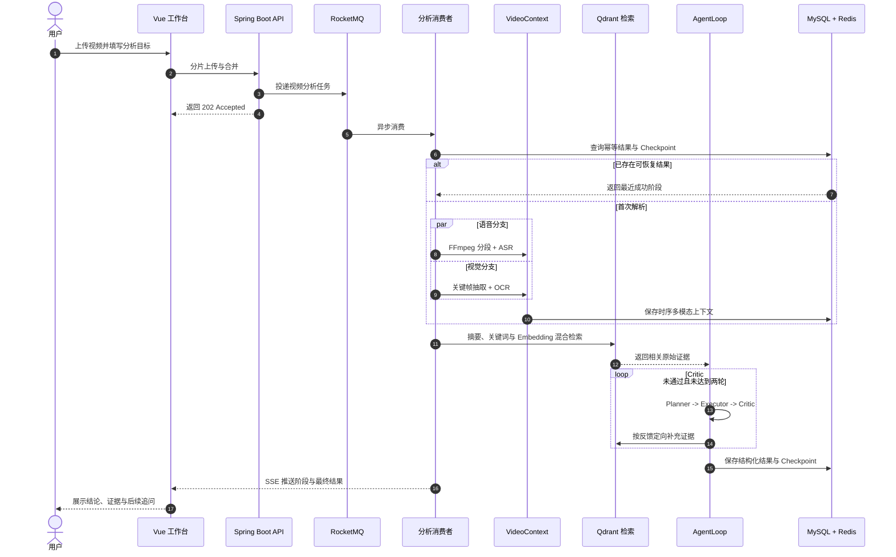

# 技术架构

视频处理涉及长耗时任务、大文件传输和外部模型调用。系统围绕任务可靠性、内容理解、目标分析与结果复用组织后端链路。

### 🎬 可靠的视频任务链路

> 把大文件上传与耗时的视频解析从请求主链路中剥离，通过异步任务、幂等控制和重试机制管理长耗时处理。

- **分片上传 + 断点续传** — 前端按 5 MB 分片，Redis 记录已完成分片，MinIO 保存合并后的视频，弱网中断后可从断点续传。
- **异步削峰** — RocketMQ 将视频解析移出请求线程，提交后立即返回任务 ID；Redisson 按「内容指纹 + 分析目标」加锁，拦截并发与重复消费。
- **成本护栏** — 用户级与全局令牌桶限制 AI 请求速率；ASR 与模型调用采用有限次数的指数退避重试，兜底第三方网络抖动。

### 🧩 时序多模态 VideoContext

> 把语音、画面文字与时间戳融合成一份可检索、可校验的统一上下文。

- **双分支抽取** — FFmpeg 将音频按 60 秒切片，同时通过场景变化检测抽取关键帧，并以 30 秒保底采样避免遗漏静态板书。
- **并行与容错** — ASR 与 OCR 使用独立有界线程池并行执行；相邻画面通过感知哈希去重，单路失败时仍保留另一条有效信息。
- **统一结构** — 语音区间、OCR 文本、关键帧与时间戳被合并为统一的 `VideoSegment`，后续检索与校验不再依赖底层模型格式。

```text
[02:00 - 03:00]
ASR      接下来讲解二叉树的前序遍历
OCR      前序遍历：根节点、左子树、右子树
Evidence frame_000125.jpg
```

### 🔁 有证据约束的 AgentLoop

> 每条结论都必须绑定可在原始视频中核验的时间戳证据，通过证据约束与程序校验降低无依据结论的风险。

- **角色分工** — Planner 将用户目标拆成可执行任务，Executor 生成固定结构的结论、证据与建议。
- **闭环校验** — Critic 检查目标覆盖、结构完整性与时间戳证据；不通过时依据缺失内容和时间范围定向重新检索。
- **自动模式路由** — 根据用户目标自动选择通用、学习、审查或创作模式；路由不可用时回退通用模式，不阻断分析任务。
- **四类结构化产物** — 通用模式生成结论与建议，学习模式生成大纲、自测题与易错点，审查模式定位逻辑漏洞与存疑结论，创作模式提取爆点、标题与口播脚本。
- **成本可控** — AgentLoop 最多执行两轮，既允许定向修正，也通过轮次上限约束延迟与 Token 成本。

### 🔍 长视频检索与断点恢复

> 面向数小时长视频的分段检索，以及分阶段可恢复的任务状态机。

- **混合检索** — 每 5 分钟生成片段摘要、关键词与 Embedding，通过关键词匹配与 Qdrant 语义召回选出 TopK 原始证据。
- **优雅降级** — Qdrant 或 Embedding 服务不可用时，退化到本地关键词与已有向量排序，不阻断主分析链路。
- **断点恢复** — Checkpoint 以 MySQL 为恢复真源、Redis 为热缓存，持久化 `VideoContext`、分块、计划、Critic 状态与最终结果。
- **状态可观测** — 前端通过 SSE 接收任务阶段；失败消息写入独立失败主题与失败任务表，可由管理接口重新投递。

## 系统流程




## 文本剪辑与 AI 智能选段

时间轴转写为总结和剪辑提供共享句段。智能选段是独立的有界后台任务，模型只返回句段编号与理由，后端校验归属、编号和时间，推荐经用户确认后应用为编辑草稿。推荐生成不走完整 AgentLoop，MP4 导出复用现有导出任务。

编辑任务使用独立有界执行器和 MySQL 状态；RocketMQ 用于视频分析链路，不能将所有后台任务都描述为消息队列消费。剪辑方案引用固定字幕版本，导出绑定已保存的方案快照。

实现与限制见 [智能选段验收](ai-smart-selection-validation.md) 和 [文本剪辑设计](text-video-editor.md)。
